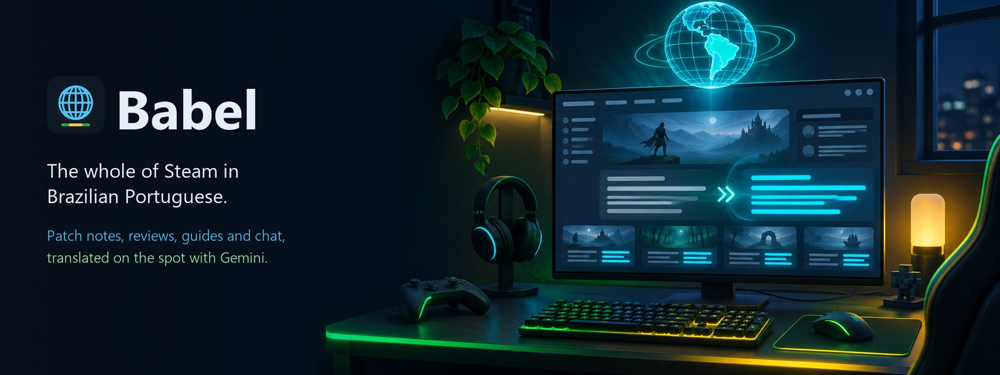

<p align="center">
  
</p>

# Babel for Steam: the whole of Steam in Brazilian Portuguese

[](https://github.com/ThalzeronLabs/babel-steam/actions/workflows/ci.yml)
[](https://github.com/ThalzeronLabs/babel-steam/releases/latest)
[](LICENSE)

[Português (Brasil)](README.md) · **English**

Steam's menus already come in Portuguese. What does not is everything **people and studios write**: patch notes,
events, reviews, discussions, guides, Workshop descriptions and many store pages. **Babel** translates all of that into
Brazilian Portuguese **on the spot, inside the Steam window**, with the user's own free Gemini API key.

- **Two-minute setup:** download, open, paste the key. No Python, no command line, no administrator rights.
- **Speaks gamer:** buff, nerf, farm, drop and GG stay the way Brazilian players say them; irony, slang and swearing stay too.
- **Never pays twice:** each piece of text is translated once and kept on the PC. Opening it again costs nothing.
- **Does not break Steam:** text is replaced in place, without touching the page structure. Alt + click shows the original.

> Babel is not made by or affiliated with Valve. Read [Privacy and risks](#privacy-and-risks) before using it.

## How it works

1. **The debugging port.** The Steam client is a Chromium browser inside (CEF). Started with its documented launch
   options `-cef-enable-debugging -devtools-port=9333`, it lets a program **on the same PC** (127.0.0.1 only) talk to its
   pages over the Chrome DevTools Protocol.
2. **The injector** checks the open pages every 1.5 s and adds the page script to each one. Page and app talk through a
   CDP *binding*: a direct channel, with no network in between.
3. **The page script** finds runs of text, skips Portuguese, game titles, URLs and short labels, and asks only for what is
   on screen (plus the next few blocks, so scrolling arrives translated). It swaps text **in place**, keeping bold,
   links and lists through `<t1>…</t1>` markers, so React views (library, chat) keep working.
4. **Translation** joins requests from every page into batches. The **SQLite cache** answers first, keyed by a SHA-256
   of the text and a version of the instructions; only new text goes to Gemini, which picks the newest Flash-Lite model
   at start-up and follows a [Brazilian gamer glossary](src/Babel/Web/glossario.txt). A failing text splits its batch
   until it is isolated, and a page cannot ask for more than 400,000 characters a minute.

If Steam is opened another way (a desktop shortcut), Babel reopens it with the port, but only with no game running,
after 45 s of stability and at most once every 10 minutes.

## Privacy and risks

- **What goes to Google:** the foreign text shown in Steam, including reviews, discussions and **chat messages written by
  other people**, sent straight from the PC to the Gemini API **with the user's key**, under the
  [Gemini API terms](https://ai.google.dev/gemini-api/terms). On the free tier, Google may use submitted content to
  improve its products. There is no Babel server.
- **The key** is stored in `%APPDATA%\Babel\gemini.key`, encrypted with Windows DPAPI for the current user.
- **Port 9333** only accepts local connections, but any program on the PC can use it while Steam runs with it, the same
  trade-off as other Steam client mods.
- **VAC:** Babel never touches games or Steam's files, only the client's pages. Still a third-party tool: low risk, not zero.

## Build

```bash
dotnet test tests/Babel.Tests
node tests/web/pagina.test.mjs
dotnet publish src/Babel -c Release -r win-x64 --self-contained -p:PublishSingleFile=true
```

C# (.NET 10, WPF), one self-contained exe. Tests cover the translation queue (batching, de-duplication, cache,
versioning, failure isolation, batch limits), model selection, key validation and DPAPI round-trip, Steam detection,
and, in JavaScript, the page script's Portuguese detector, title detector and markup parser.

## How I build this

I use AI assistance (Claude) while I build this project: for drafting, exploring options and writing tests. The banner
illustration was made with an image model. I review every change, use Babel every day on my own Steam, and I'm
responsible for every line.

Steam is a trademark of Valve Corporation. This project is not affiliated with Valve or Google.

## License

Apache-2.0 © Esdras Souza (Thalzeron Labs). See [LICENSE](LICENSE).
