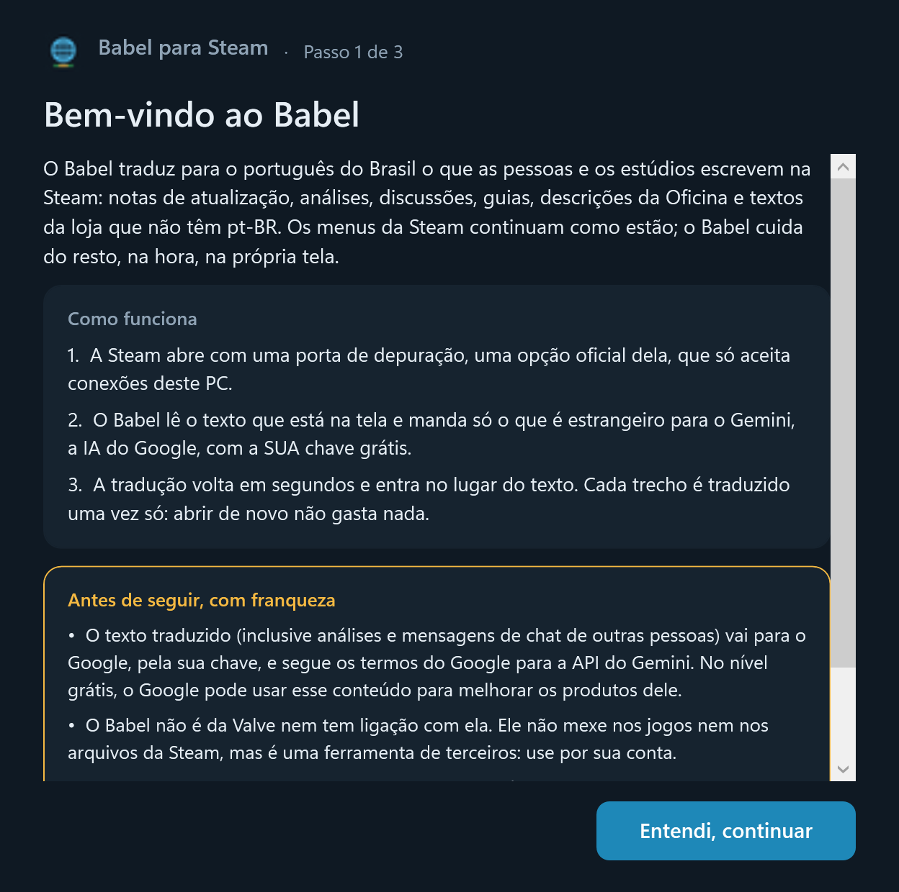
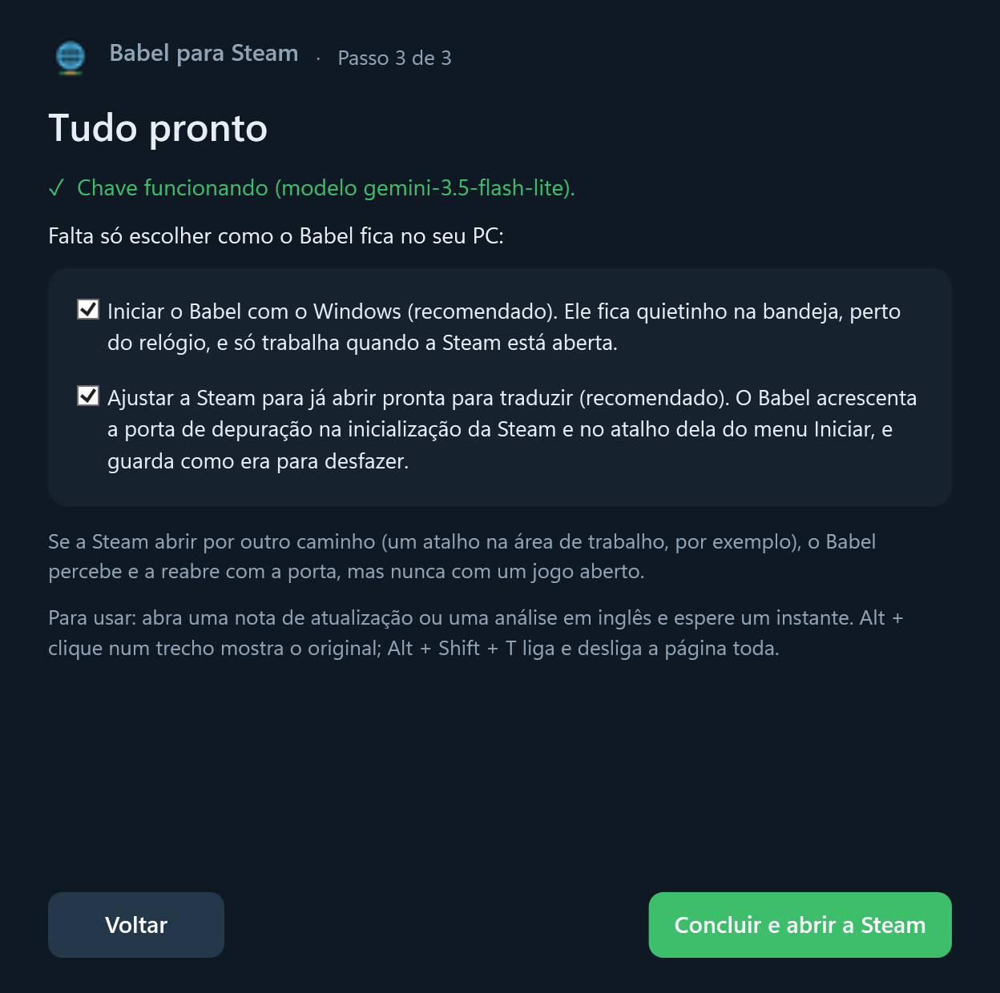
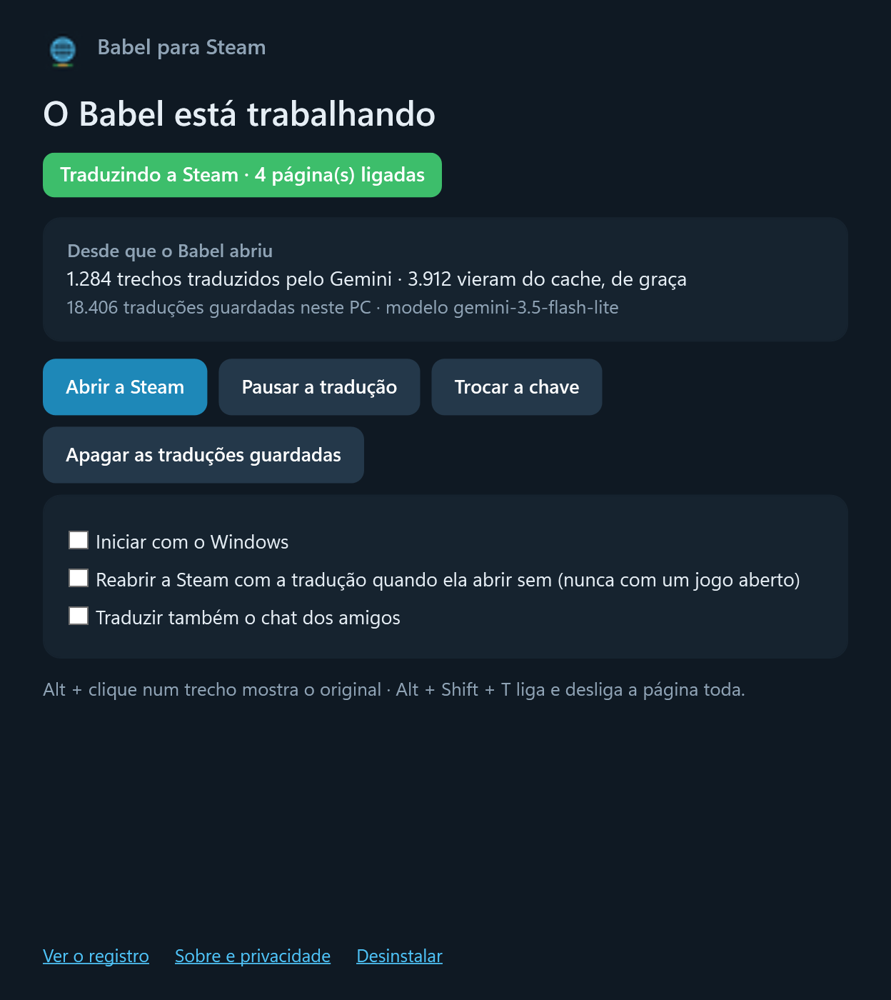

<p align="center">
  
</p>

# Babel para Steam: a Steam inteira em português do Brasil

[](https://github.com/ThalzeronLabs/babel-steam/actions/workflows/ci.yml)
[](https://github.com/ThalzeronLabs/babel-steam/releases/latest)
[](#o-que-precisa)
[](LICENSE)

**Português (Brasil)** · [English](README.en.md)

A Steam já tem os menus em português. O que não tem é o que **as pessoas e os estúdios escrevem**: as notas de
atualização, os eventos, as análises, as discussões, os guias, as descrições da Oficina e muita página de loja. O
**Babel** traduz tudo isso para o português do Brasil **na hora, na própria tela da Steam**, com a sua chave grátis do
Gemini, a IA do Google.

- **Instala em 2 minutos:** baixe, abra, cole a chave. Sem Python, sem linha de comando, sem administrador.
- **Traduz como gamer fala:** buff, nerf, farmar, drop e GG ficam como a gente fala; ironia, gíria e palavrão continuam lá.
- **Não paga duas vezes:** cada trecho é traduzido uma vez e fica guardado no seu PC. Abrir de novo não gasta nada.
- **Não quebra a Steam:** o texto é trocado no lugar, sem mexer na estrutura da página. Alt + clique mostra o original.

> O Babel para Steam é independente e não tem ligação com a Valve. Leia o [aviso](#privacidade) antes de usar.

## Como fica

| A configuração da primeira vez | A chave grátis | Pronto | O painel |
|---|---|---|---|
|  |  |  |  |

Essas imagens são desenhadas pelo próprio código das janelas (`Babel.exe render docs/images`); o painel usa números de
exemplo.

## Instalar

1. **Baixe** o `Babel-vX.Y.Z-win-x64.zip` na [última versão](https://github.com/ThalzeronLabs/babel-steam/releases/latest),
   descompacte e abra o `Babel.exe`. O exe ainda não tem assinatura digital, então o Windows pode perguntar
   *"Executar assim mesmo?"* na primeira vez. Cada versão traz o SHA-256 dos arquivos para você conferir.
2. **Leia o aviso** da primeira tela (o que vai para o Google e por quê) e clique em *Entendi, continuar*.
3. **Pegue a chave grátis**: o botão *Abrir o Google AI Studio* leva à página certa; entre com a sua conta do Google,
   clique em *Criar chave de API*, copie a chave (começa com `AIza`) e cole no Babel. Ele confere com o Google na hora.
4. **Escolha e conclua.** Você decide se o Babel ajusta a Steam para já abrir pronta para traduzir, ou se prefere abrir
   a Steam pelo botão do Babel quando quiser a tradução (nada vem marcado). O Babel se copia para
   `%LOCALAPPDATA%\Programs\Babel`, entra no menu Iniciar e fica na bandeja, o globo perto do relógio.

Depois disso, é só usar a Steam. Abra uma nota de atualização ou uma análise em inglês e espere um instante.

| O quê | Como |
|---|---|
| Ver o original de um trecho | **Alt + clique** no trecho (o fio azul à esquerda fica laranja) |
| Desligar e ligar a página toda | **Alt + Shift + T** |
| Saber de onde veio | passe o mouse: "Traduzido do inglês pelo Babel" |
| Pausar tudo | botão direito no globo da bandeja → *Pausar a tradução* |

## O que precisa

- Windows 10 ou 11 (64 bits) e a Steam instalada.
- Uma conta do Google para criar a chave do Gemini (grátis, sem cartão).
- Internet: cada texto novo vai ao Gemini; o que já foi traduzido vem do seu PC.

## Como funciona

1. **A porta de depuração.** O aplicativo da Steam é, por dentro, um navegador Chromium (o CEF). Aberta com a opção
   oficial `-cef-enable-debugging -devtools-port=9333`, ela deixa um programa **deste PC** (só `127.0.0.1`) conversar
   com as páginas dela pelo mesmo protocolo do DevTools do Chrome.
2. **O injetor.** A cada 1,5 s o Babel olha as páginas abertas e põe nelas o script de tradução. A página e o Babel
   conversam por um canal direto (uma *binding*), sem rede no meio.
3. **O script da página.** Acha os trechos de texto, pula o que já está em português, nomes de jogos, endereços e textos
   curtos, e pede a tradução **só do que está na tela** (e dos próximos trechos, para a rolagem chegar pronta). Troca
   o texto **no lugar**: negrito, links e listas viram marcas (`<t1>…</t1>`) e voltam para o lugar certo.
4. **A tradução.** Os pedidos de todas as páginas são juntados em lotes. O **cache** responde primeiro; só o texto
   nunca visto vai ao Gemini, que escolhe na hora o modelo Flash-Lite mais novo e segue um
   [glossário gamer brasileiro](src/Babel/Web/glossario.txt).

### As travas

- **Só páginas permitidas.** O Babel entra só na janela principal da Steam, na loja e na comunidade, e nelas **nunca**
  traduz as páginas de conta, carteira, pagamento, compras, login, trocas, mercado, inventário e edição de perfil.
  Qualquer outra janela do cliente (chat, amigos, login, configurações, menus) fica de fora. É uma lista do que pode,
  não do que não pode: uma janela nova da Steam começa fora.
- **O chat vem desligado.** As mensagens dos amigos são dados pessoais de outras pessoas. Quem ligar vê o aviso e a
  recomendação de usar uma chave paga.
- **Só a Steam de verdade.** Antes de injetar, o Babel confere que a porta pertence ao `steamwebhelper.exe` da pasta da
  própria Steam, e só se conecta no `127.0.0.1`, na porta configurada.
- **Cinco comandos, e só.** Do protocolo do DevTools, o Babel usa `Runtime.enable`, `Runtime.addBinding`, `Page.enable`,
  `Page.addScriptToEvaluateOnNewDocument` e `Runtime.evaluate`. Nada de cookies, armazenamento, rede ou cliques; um teste
  falha se aparecer qualquer outro.
- **Nada sozinho na sua conta.** O script da página só troca o texto que já está na tela: não clica, não posta, não manda
  mensagem, não compra. Não toca nos jogos, no overlay nem nos arquivos da Steam.
- **Limites de uso.** Além de um limite por página, o Babel inteiro manda no máximo 200 mil caracteres por minuto e 2
  milhões por dia ao Gemini (dá para mudar nas configurações).
- **Reabrir a Steam vem desligado.** Se você ligar a opção, o Babel reabre a Steam com a porta quando ela abrir sem, mas
  só sem jogo aberto, depois de 45 s estável e no máximo uma vez a cada 10 minutos.

<a id="privacidade"></a>
## Aviso, segurança e privacidade

> **Aviso.** O Babel é um projeto independente e não é afiliado, patrocinado nem aprovado pela Valve. Steam e o logotipo da Steam são marcas comerciais e/ou registradas da Valve Corporation nos EUA e/ou em outros países. O Babel usa uma opção de depuração do próprio cliente da Steam e altera o texto exibido na tela. Ele não altera os arquivos de programa da Steam, não toca nos jogos e não faz nada sozinho na sua conta. Com o seu OK, o instalador muda o atalho e a inicialização da Steam para abrir com essa opção, e o desinstalador desfaz a mudança. O Acordo de Assinatura da Steam proíbe modificar o cliente sem autorização da Valve, e a Valve pode restringir contas. **Use por sua conta e risco.**
>
> **Segurança.** Enquanto a Steam estiver aberta com a opção de depuração, com ou sem o Babel rodando, qualquer programa do seu computador pode controlar a Steam já logada, inclusive fazer compras com a carteira (a porta só atende no próprio PC, 127.0.0.1). Só use o Babel num computador em que você confia, e abra a Steam do jeito normal quando não precisar da tradução. O Babel nunca traduz as páginas de conta, carteira, pagamento e login.
>
> **Gemini.** Você usa a sua própria chave do Google AI Studio e aceita os [termos do Google](https://ai.google.dev/gemini-api/terms); a cota e a conta são suas. A API do Gemini exige 18 anos ou mais. No nível grátis, o Google usa o texto enviado para melhorar os produtos dele, e pessoas podem lê-lo. Não envie dados pessoais nesse nível. Na União Europeia, na Suíça e no Reino Unido, só a chave paga é permitida. A tradução do chat vem desligada. Para ligá-la, use uma chave com faturamento ativado. O Babel não tem servidor: nada passa por nós.

- **O que vai para o Google:** só o texto estrangeiro das páginas permitidas, sem apelido, avatar, ID nem horário de quem
  escreveu. Não há conta, servidor nem telemetria do Babel.
- **A sua chave** fica em `%APPDATA%\Babel\gemini.key`, cifrada pelo Windows (DPAPI): só o seu usuário, neste PC,
  consegue abrir. Ela nunca vai para a tela nem para o registro de atividades.
- **As traduções** ficam só neste PC, em `%APPDATA%\Babel\cache.sqlite`, nunca compartilhadas. O painel tem o botão
  *Apagar as traduções guardadas*.
- **VAC:** o VAC vigia os jogos, e o Babel não toca neles. Ainda assim, é uma ferramenta de terceiros: risco baixo, não zero.
- **Atualizações da Steam** podem mudar a opção de depuração. O Babel não quebra a Steam: no pior caso, para de traduzir.

## Desinstalar

No painel do Babel, *Desinstalar*: a Steam volta a abrir como era (o Babel guardou como estava), o Babel sai do menu
Iniciar e da inicialização do Windows, e você escolhe se apaga a chave e o cache. Se a Steam estiver aberta com a porta
(e sem jogo), o Babel oferece reiniciá-la do jeito normal, para fechar a porta na hora. Depois, apague a pasta
`%LOCALAPPDATA%\Programs\Babel`.

O que o Babel guarda: as configurações, a chave e o cache em `%APPDATA%\Babel`; o registro de atividades em
`%LOCALAPPDATA%\Babel\babel.log`; e o atalho no menu Iniciar.

## Perguntas frequentes

**Quanto custa?** O Babel é grátis, e a chave do Gemini também. O nível grátis do Gemini tem limites de uso por minuto e
por dia, que o Google muda de tempos em tempos (veja os [limites atuais](https://ai.google.dev/gemini-api/docs/rate-limits)).
O Babel economiza o que pode: só traduz o que está na tela, junta os textos em lotes e guarda cada tradução para nunca
pedir a mesma duas vezes. Se o Google disser que o limite foi atingido, ele espera e tenta de novo.

**O Babel diz que o crédito acabou.** A chave é de um projeto do Google com cobrança pré-paga, e o saldo zerou. Enquanto
for assim, o Google recusa toda tradução. O mais simples é criar uma chave nova num projeto sem cobrança, porque o nível
grátis basta para o uso normal. A outra saída é pôr crédito no [AI Studio](https://aistudio.google.com/). O teste da
chave na configuração traduz uma palavra, e por isso já pega esse caso antes de você terminar. Se acontecer depois, o
Babel avisa pela bandeja e para de pedir por um minuto, em vez de insistir.

**Por que não usar o tradutor do navegador?** Porque a Steam não é um navegador comum: a biblioteca, as notas de
atualização e o chat ficam dentro do aplicativo, onde o tradutor do navegador não chega.

**E se eu quiser outro idioma?** Hoje o Babel traduz para o português do Brasil. Outros idiomas estão nos
[próximos passos](#proximos-passos).

## Compilar você mesmo

```bash
dotnet test tests/Babel.Tests
node tests/web/pagina.test.mjs
dotnet publish src/Babel -c Release -r win-x64 --self-contained -p:PublishSingleFile=true
```

Os testes cobrem a fila de tradução (lotes, sem repetir, o cache, o texto que falha sozinho, os limites), a escolha do
modelo, a chave (o formato e a cifra do Windows), as travas (as páginas permitidas e as sensíveis, o chat desligado, só o
`127.0.0.1`, os cinco comandos, o dono da porta), o caminho inteiro numa Steam de mentira e, em JavaScript, as regras do
script da página (o detector de português, o de títulos e as marcas de formatação). `Babel.exe check` mostra, sem
injetar nada, quem é o dono da porta e o que o Babel faria com cada página (sem títulos de janela, pode ir numa issue).

<a id="proximos-passos"></a>
## Próximos passos

- Outros idiomas de destino.
- Um pacote no `winget`.
- A assinatura digital do exe.

## Como eu construo isto

Eu uso a assistência de IA (o Claude) enquanto construo este projeto: para rascunhar, explorar opções e escrever os
testes. A ilustração do topo foi feita com um modelo de imagem. Eu reviso cada mudança, uso o Babel todo dia na minha
própria Steam e respondo por cada linha.

## Sobre

O Babel nasceu como um script na minha Steam, porque eu queria ler as notas de atualização e as análises sem trocar de
janela, e virou um programa quando ficou bom o bastante para qualquer pessoa usar. Eu sou o Esdras Souza,
desenvolvedor Android e de IA, e publico os meus projetos abertos na
[Thalzeron Labs](https://thalzeronlabs.github.io/Site-Oficial/). Outro projeto para PC:
[DuoGPU](https://github.com/ThalzeronLabs/duogpu) (o monitor principal entre duas placas de vídeo, um clique).

### Componentes de terceiros

| Componente | Licença |
|---|---|
| [Microsoft.Data.Sqlite](https://github.com/dotnet/efcore) | MIT |
| [SQLitePCLRaw](https://github.com/ericsink/SQLitePCL.raw) | Apache-2.0 |
| [SQLite](https://sqlite.org/copyright.html) | domínio público |
| .NET e WPF | MIT |

Os textos completos das licenças e os avisos de cada componente estão em [THIRD-PARTY-NOTICES.txt](THIRD-PARTY-NOTICES.txt),
que também vai dentro do .zip de cada versão.

Steam é uma marca da Valve Corporation. Este projeto não tem ligação com a Valve nem com o Google.

## Licença

Apache-2.0 © Esdras Souza (Thalzeron Labs). Veja a [LICENSE](LICENSE).
