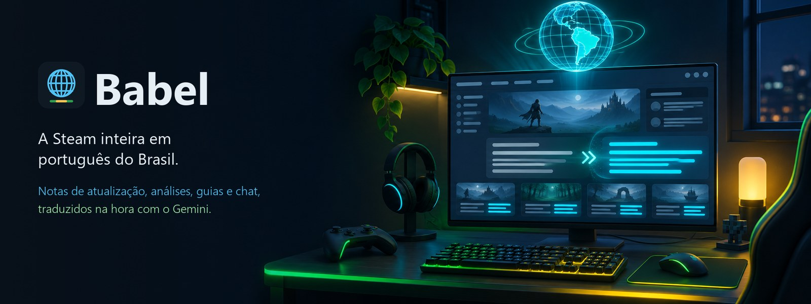
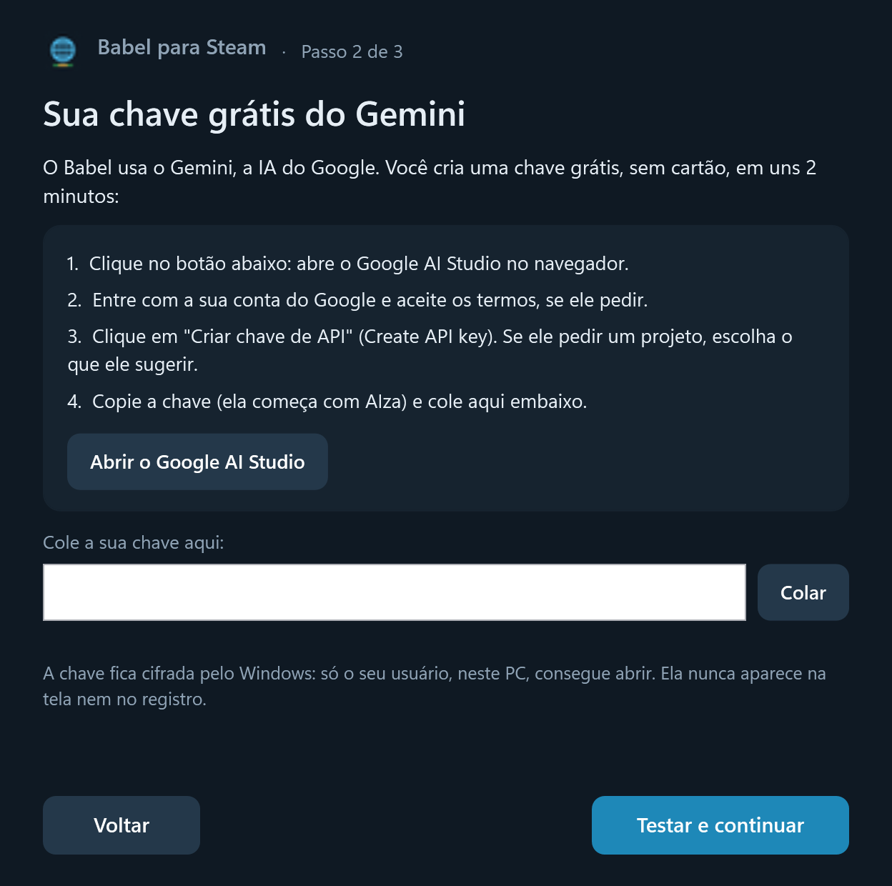

<p align="center">
  
</p>

# Babel para Steam: a Steam inteira em português do Brasil

[](https://github.com/ThalzeronLabs/babel-steam/actions/workflows/ci.yml)
[](https://github.com/ThalzeronLabs/babel-steam/releases/latest)
[](#o-que-precisa)
[](LICENSE)

**Português (Brasil)** · [English](README.en.md)

A Steam já tem os menus em português. O que não tem é o que **as pessoas e os estúdios escrevem**: as notas de
atualização, os eventos, as análises, as discussões, os guias, as descrições da Oficina e muita página de loja. O
**Babel** traduz tudo isso para o português do Brasil **na hora, na própria tela da Steam**, com a sua chave grátis do
Gemini, a IA do Google.

- **Instala em 2 minutos:** baixe, abra, cole a chave. Sem Python, sem linha de comando, sem administrador.
- **Traduz como gamer fala:** buff, nerf, farmar, drop e GG ficam como a gente fala; ironia, gíria e palavrão continuam lá.
- **Não paga duas vezes:** cada trecho é traduzido uma vez e fica guardado no seu PC. Abrir de novo não gasta nada.
- **Não quebra a Steam:** o texto é trocado no lugar, sem mexer na estrutura da página. Alt + clique mostra o original.

> O Babel não é da Valve nem tem ligação com ela. Leia [Privacidade e riscos](#privacidade) antes de usar.

## Como fica

| A configuração da primeira vez | A chave grátis | Pronto | O painel |
|---|---|---|---|
|  |  |  |  |

Essas imagens são desenhadas pelo próprio código das janelas (`Babel.exe render docs/images`); o painel usa números de
exemplo.

## Instalar

1. **Baixe** o `Babel-vX.Y.Z-win-x64.zip` na [última versão](https://github.com/ThalzeronLabs/babel-steam/releases/latest),
   descompacte e abra o `Babel.exe`. O exe ainda não tem assinatura digital, então o Windows pode perguntar
   *"Executar assim mesmo?"* na primeira vez. Cada versão traz o SHA-256 dos arquivos para você conferir.
2. **Leia o aviso** da primeira tela (o que vai para o Google e por quê) e clique em *Entendi, continuar*.
3. **Pegue a chave grátis**: o botão *Abrir o Google AI Studio* leva à página certa; entre com a sua conta do Google,
   clique em *Criar chave de API*, copie a chave (começa com `AIza`) e cole no Babel. Ele confere com o Google na hora.
4. **Conclua.** O Babel se copia para `%LOCALAPPDATA%\Programs\Babel`, entra no menu Iniciar, fica na bandeja (o globo
   perto do relógio) e abre a Steam pronta para traduzir.

Depois disso, é só usar a Steam. Abra uma nota de atualização ou uma análise em inglês e espere um instante.

| O quê | Como |
|---|---|
| Ver o original de um trecho | **Alt + clique** no trecho (o fio azul à esquerda fica laranja) |
| Desligar e ligar a página toda | **Alt + Shift + T** |
| Saber de onde veio | passe o mouse: "Traduzido do inglês pelo Babel" |
| Pausar tudo | botão direito no globo da bandeja → *Pausar a tradução* |

## O que precisa

- Windows 10 ou 11 (64 bits) e a Steam instalada.
- Uma conta do Google para criar a chave do Gemini (grátis, sem cartão).
- Internet: cada texto novo vai ao Gemini; o que já foi traduzido vem do seu PC.

## Como funciona

1. **A porta de depuração.** O aplicativo da Steam é, por dentro, um navegador Chromium (o CEF). Aberta com a opção
   oficial `-cef-enable-debugging -devtools-port=9333`, ela deixa um programa **deste PC** (só `127.0.0.1`) conversar
   com as páginas dela pelo mesmo protocolo do DevTools do Chrome.
2. **O injetor.** A cada 1,5 s o Babel olha as páginas abertas e põe nelas o script de tradução. A página e o Babel
   conversam por um canal direto (uma *binding*), sem rede no meio.
3. **O script da página.** Acha os trechos de texto, pula o que já está em português, nomes de jogos, endereços e textos
   curtos, e pede a tradução **só do que está na tela** (e dos próximos trechos, para a rolagem chegar pronta). Troca
   o texto **no lugar**: negrito, links e listas viram marcas (`<t1>…</t1>`) e voltam para o lugar certo.
4. **A tradução.** Os pedidos de todas as páginas são juntados em lotes. O **cache** responde primeiro; só o texto
   nunca visto vai ao Gemini, que escolhe na hora o modelo Flash-Lite mais novo e segue um
   [glossário gamer brasileiro](src/Babel/Web/glossario.txt).

Se a Steam abrir por outro caminho (um atalho da área de trabalho, por exemplo), o Babel percebe e a reabre com a porta,
mas **só sem jogo aberto**, depois de 45 s estável e no máximo uma vez a cada 10 minutos.

<a id="privacidade"></a>
## Privacidade e riscos, com franqueza

- **O que vai para o Google:** o texto estrangeiro que aparece na sua tela da Steam, inclusive análises, discussões e
  **mensagens de chat escritas por outras pessoas**. Ele vai direto do seu PC para a API do Gemini, **pela sua chave**,
  e segue os [termos da API do Gemini](https://ai.google.dev/gemini-api/terms). No nível grátis, o Google pode usar o
  conteúdo enviado para melhorar os produtos dele. Nada passa por nós: não há servidor do Babel.
- **A sua chave** fica em `%APPDATA%\Babel\gemini.key`, cifrada pelo Windows (DPAPI): só o seu usuário, neste PC,
  consegue abrir. Ela nunca vai para a tela nem para o registro de atividades.
- **A porta 9333** só aceita conexões do próprio PC, mas **qualquer programa do PC** pode usá-la enquanto a Steam
  estiver aberta com ela. É o mesmo risco de qualquer mod da Steam (como o Millennium ou o Decky Loader). Um vírus no
  PC já seria um problema maior que esse.
- **VAC:** o Babel não toca nos jogos nem nos arquivos da Steam; ele age só nas páginas do cliente. O VAC vigia os
  jogos. Ainda assim, é uma ferramenta de terceiros, sem nada de oficial da Valve: risco baixo, não zero.
- **Atualizações da Steam** podem mudar a porta de depuração. O Babel não quebra a Steam: no pior caso, ele para de
  traduzir até uma versão nova.

## Desinstalar

No painel do Babel, *Desinstalar*: a Steam volta a abrir como era (o Babel guardou como estava), o Babel sai do menu
Iniciar e da inicialização do Windows, e você escolhe se apaga a chave e o cache. Depois, apague a pasta
`%LOCALAPPDATA%\Programs\Babel`.

O que o Babel guarda: as configurações, a chave e o cache em `%APPDATA%\Babel`; o registro de atividades em
`%LOCALAPPDATA%\Babel\babel.log`; e o atalho no menu Iniciar.

## Perguntas frequentes

**Quanto custa?** O Babel é grátis, e a chave do Gemini também. O nível grátis do Gemini tem limites de uso por minuto e
por dia, que o Google muda de tempos em tempos (veja os [limites atuais](https://ai.google.dev/gemini-api/docs/rate-limits)).
O Babel economiza o que pode: só traduz o que está na tela, junta os textos em lotes e guarda cada tradução para nunca
pedir a mesma duas vezes. Se o Google disser que o limite foi atingido, ele espera e tenta de novo.

**Por que não usar o tradutor do navegador?** Porque a Steam não é um navegador comum: a biblioteca, as notas de
atualização e o chat ficam dentro do aplicativo, onde o tradutor do navegador não chega.

**E se eu quiser outro idioma?** Hoje o Babel traduz para o português do Brasil. Outros idiomas estão nos
[próximos passos](#proximos-passos).

## Compilar você mesmo

```bash
dotnet test tests/Babel.Tests
node tests/web/pagina.test.mjs
dotnet publish src/Babel -c Release -r win-x64 --self-contained -p:PublishSingleFile=true
```

Os testes cobrem a fila de tradução (lotes, sem repetir, o cache, o texto que falha sozinho), a escolha do modelo, a
chave (o formato e a cifra do Windows), o reconhecimento da Steam e, em JavaScript, as regras do script da página (o
detector de português, o de títulos e as marcas de formatação).

<a id="proximos-passos"></a>
## Próximos passos

- Outros idiomas de destino.
- Um pacote no `winget`.
- Uma opção para não traduzir o chat.

## Como eu construo isto

Eu uso a assistência de IA (o Claude) enquanto construo este projeto: para rascunhar, explorar opções e escrever os
testes. A ilustração do topo foi feita com um modelo de imagem. Eu reviso cada mudança, uso o Babel todo dia na minha
própria Steam e respondo por cada linha.

## Sobre

O Babel nasceu como um script na minha Steam, porque eu queria ler as notas de atualização e as análises sem trocar de
janela, e virou um programa quando ficou bom o bastante para qualquer pessoa usar. Eu sou o Esdras Souza,
desenvolvedor Android e de IA, e publico os meus projetos abertos na
[Thalzeron Labs](https://thalzeronlabs.github.io/Site-Oficial/). Outro projeto para PC:
[DuoGPU](https://github.com/ThalzeronLabs/duogpu) (o monitor principal entre duas placas de vídeo, um clique).

Steam é uma marca da Valve Corporation. Este projeto não tem ligação com a Valve nem com o Google.

## Licença

Apache-2.0 © Esdras Souza (Thalzeron Labs). Veja a [LICENSE](LICENSE).
